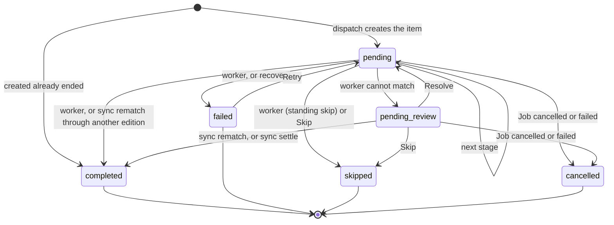
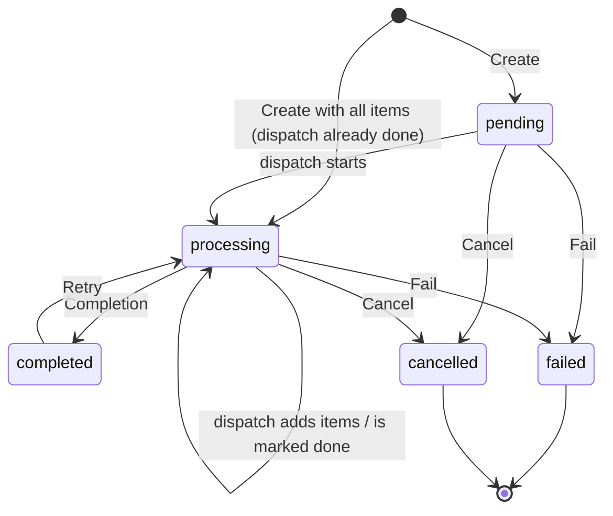

# Job lifecycle

How a **Job** and its **Job items** move from creation to an ended state, who is allowed to move them, and what must always be true along the way. Terms in bold are defined in [`GLOSSARY.md`](../GLOSSARY.md).

Every Job kind follows this document; the code was moved onto it one kind at a time (epic [#1265](https://github.com/drzero42/nexorious/issues/1265)).

| Job kind | Follows this document |
|---|---|
| Metadata refresh | yes |
| Store-link refresh | yes |
| Export | yes |
| Generic import (registry sources, CSV) | yes |
| Nexorious import | yes |
| Sync | yes |

## What the lifecycle guarantees

1. **No stuck Jobs.** Every Job either ends or visibly waits on the user.
2. **Nothing ended is changed by accident.** An ended Job or item is never altered by a late or duplicate worker.
3. **User actions mean one thing.** Resolve, Skip, Retry and Cancel behave the same on every path and for every Job kind.
4. **Restarts are invisible.** A shutdown or crash never shows up as a failed or stuck Job. The one exception is work that has already taken the process down on every attempt it was allowed: that is failed, so it cannot do it forever.

Everything below exists to keep these four promises. When a change to the code is being considered, check it against the [invariants](#invariants); they are the test of whether the promises still hold.

## One owner

One package, `internal/joblifecycle` (the module), makes every change to `jobs.status`, `job_items.status` and `jobs.dispatch_complete`, and creates every Job and item. Workers, HTTP handlers and the scheduler ask the module for a transition; they never write these columns themselves.

Each Job kind registers with the module and tells it what is particular to the kind:

- the River job kinds it uses for its dispatch and its items;
- which worker runs an item when the module queues it by itself (Resolve, Retry, recovery). A worker that hands an item on names the next stage itself;
- how to run the Job's dispatch again, or that it cannot be run again;
- what counts as a duplicate Job;
- its ending effects and, optionally, a metrics observer.

The module does not import the workers.

## States

**Job**

| Status | Meaning |
|---|---|
| `pending` | Created; its dispatch has not started |
| `processing` | Its dispatch has started, or its items are being worked, or it waits on the user |
| `completed` | Ended: nothing is left for a worker or the user |
| `failed` | Ended by an error |
| `cancelled` | Ended by the user |

`pending` and `processing` are *active*. The other three are *ended*.

**Job item**

| Status | Meaning |
|---|---|
| `pending` | A worker acts next |
| `pending_review` | The user acts next (Resolve or Skip) |
| `completed` | Ended: the work was done |
| `failed` | Ended by an error; can be retried |
| `skipped` | Ended: the user, or a standing skip on the game, said not to do it |
| `cancelled` | Ended because its Job was cancelled or failed |

`pending` and `pending_review` are *open*. The status of an open item only says who acts next. It never records a decision: the IGDB game chosen for an item is kept in `resolved_igdb_id`.

`processing` remains a legal value of `job_items.status` for rows written by older versions. Nothing writes it any more. Only the old import resolve handler ever did, and the migration that moves the import kinds turns those items into `pending`.

## Owners

Work on an item or on a dispatch is done by a River job. The lifecycle records which one:

- A `pending` item records the River job that **owns** it (`job_items.river_job_id`).
- A Job whose dispatch is not done records its dispatch River job the same way (`jobs.river_job_id`).

The owner is recorded in the same transaction that inserts the River job (see [ADR 0001](adr/0001-enqueue-river-jobs-in-the-status-transaction.md)). The record is cleared in the transaction that takes the item out of `pending`, or marks the dispatch done.

**Only the owner writes.** An item worker may change only an item it owns; a dispatch worker may change only a Job whose dispatch it owns. The check is made inside the transaction, under the Job row lock. A River retry of the owning River job is still the owner. Any other River job for the same item or Job is refused and exits without doing anything. So is the owner itself once its item is no longer `pending`: a worker that committed its result and is then run again (after a crash) finds nothing to own.

**Live.** A River job is *live* while its state is `available`, `scheduled`, `retryable`, `pending` or `running`. It has *ended* when its state is `completed`, `cancelled` or `discarded`, or when its row is gone (River deletes ended rows after a day or more).

**Signalled.** Cancelling a River job that is `running` does not end it. River marks it (`metadata.cancel_attempted_at`) and notifies the worker, whose context is then cancelled; the row stays `running` until the worker returns. Such a River job is *signalled*.

A `pending` item without an owner is always an orphan: recovery gives it one.

## Item transitions

| From | To | Trigger | In the same transaction |
|---|---|---|---|
| (new) | `pending` | Dispatch | River job inserted and recorded as owner |
| (new) | `completed` | Dispatch | Nothing. Used for an item that carries data for an ending effect (the nexorious import's pools) |
| `pending` | `pending` | The owner hands the item to its next stage | The owner's own writes for that step; new River job inserted; it replaces the old owner |
| `pending` | `pending_review` | The owner cannot match the item | Owner cleared; candidates stored; completion evaluated |
| `pending` | `completed`, `failed` or `skipped` | The owner | The owner's own result (invariant 8); owner cleared; completion evaluated |
| `pending` | `failed` | Recovery: the owner ended without changing the item | Owner cleared; completion evaluated |
| `pending_review` | `pending` | Resolve (imports) | Chosen IGDB game stored; River job inserted and recorded |
| `pending_review` | `completed` | Sync rematch of a game in Pending review | The library write itself (see [Outside the lifecycle](#outside-the-lifecycle)); completion evaluated |
| `pending_review` | `completed` | Sync settle: a search matched a same-title game of the Job with confidence, and this game takes that match (no user action) | The library write for this game; completion evaluated |
| `pending` | `completed` | Sync rematch through another edition of its game | The library write for this game too; owning River job cancelled, if any; completion evaluated |
| `pending_review` | `skipped` | Skip | Completion evaluated |
| `pending` | `skipped` | Skip of the game (sync only) | Owning River job cancelled, if any; completion evaluated |
| `failed` | `pending` | Retry | Job reopened if it was `completed`; River job inserted and recorded |
| `pending` or `pending_review` | `cancelled` | Cancel or Fail of the Job | The Job's queued River jobs cancelled, its running ones signalled |

No other item transition exists. In particular, nothing moves an item out of `completed`, `skipped` or `cancelled`. Recovery can also give a `pending` item a new owner without changing its status; see [Recovery](#recovery).

## Job transitions

| From | To | Trigger | In the same transaction |
|---|---|---|---|
| (new) | `pending` | Create with a dispatch | Duplicate check under an advisory lock; `dispatch_complete` written as `false`; dispatch River job inserted and recorded |
| (new) | `processing` | Create with all items, when the creator inserts every item itself | Duplicate check under the lock; items and their River jobs inserted; dispatch marked done; completion evaluated |
| `pending` | `processing` | The dispatch owner starts the dispatch | Refused when the Job is not active, when the caller is not the dispatch owner, or when the dispatch is already done. A dispatch that is run again finds the Job `processing` and continues |
| `processing` | `processing` | The dispatch owner adds items, or marks the dispatch done | Items and their River jobs inserted; on "done": the owner's own writes, dispatch owner cleared, completion evaluated |
| `processing` | `completed` | Completion (below). Never requested by a caller | Ending effects queued |
| active | `failed` | Fail, by the dispatch owner or by recovery | The caller's own writes; open items cancelled; River jobs cancelled or signalled, except the calling River job itself; ending effects queued |
| active | `cancelled` | Cancel, by the user | Open items cancelled; River jobs cancelled or signalled |
| `completed` | `processing` | Retry | The retried items' transitions |

A `failed` or `cancelled` Job is never reopened. Its dispatch may not be done, so it could never complete; the user starts a new sync or import instead.

### Retry

- Retry applies to `failed` items only, in a Job that is active or `completed`. On a `failed` or `cancelled` Job it is refused (HTTP 409).
- Retry of a Job with no failed items changes nothing. It does not reopen the Job.
- Reopening a `completed` Job takes the kind's duplicate lock. If another Job with the same duplicate key is active, Retry is refused (409): there is never more than one active Job per duplicate key.
- A reopened Job completes again through the normal rule, and its ending effects run again.

### What each transition writes besides status

| Column | Written |
|---|---|
| `jobs.started_at` | When the dispatch first starts, or at Create with all items |
| `jobs.completed_at` | At every end. Retry does not clear it; a Job that has never ended has it `NULL`, which is how a first end is told from a later one |
| `jobs.error_message` | By Fail |
| `job_items.processed_at` | When the item ends. Cleared by Retry |
| `job_items.error_message` | When the item fails. Cleared by Retry |
| `job_items.river_job_id` | Set with every River insert for the item; cleared whenever the item leaves `pending` |
| `job_items.resolved_igdb_id` | By Resolve, and by a worker's hand-over to the next stage |
| `job_items.resolved_at` | By Resolve: when the user chose the game |

Error messages are passed through `logging.ScrubURLQueries` before they are stored (#937).

## Completion

Completion is not an operation callers perform. The module evaluates it inside every transaction that changes an item or marks the dispatch done, with the Job row locked, so two items ending at the same moment cannot both miss it.

| Outcome | Condition | Effect |
|---|---|---|
| Still working | The dispatch is not done, or a `pending` item has an owner | None |
| Waiting on the user | The dispatch is done, no `pending` item has an owner, and at least one item is `pending_review` | The Job stays `processing`. When any transition other than a user action (Resolve, Skip, Retry, rematch) produces this outcome, the kind's *awaiting review* effect is queued; a user action that leaves the Job still waiting does not queue it again |
| Completed | The dispatch is done and no item is `pending` or `pending_review` | The Job becomes `completed`; ending effects are queued |

One combination is left: the dispatch is done, the only `pending` items have no owner, and nothing is in Pending review. No transition produces it: a `pending` item always gets an owner in the transaction that makes it `pending`. It means orphans, left over from an older version or by a defect, and the Job stays `processing` until recovery queues them.

A Job waiting on the user stays `processing` for as long as it takes. For sync this means a storefront with games in **Pending review** does not start a new sync until they are resolved or skipped.

## Ending effects

Notifications, the sync diff, the store-link refresh that follows a sync, and applying imported pools are *ending effects*. They are not run inline. The transaction that completes or fails a Job, or that finds it waiting on the user, inserts one River job that runs them, so a shutdown right after the transition cannot lose them. A kind with no effects for an outcome gets no River job.

- The effects River job carries the Job id, the outcome (`completed`, `failed` or `awaiting_review`), whether this is the Job's first end, and a small piece of kind data given to Fail.
- Effects can run more than once (a River retry, or a Job that is retried and completes again), so each must be idempotent for its Job. Notifications are, through their dedup key.
- An effect that fails returns its error so River retries the job. The effects River job has several attempts. If they are all used up the failure is logged as an error, which alerting picks up; the Job's status is not changed.
- An effect whose Job no longer exists does nothing. The awaiting-review effect also does nothing when its Job is no longer active (it was queued just before a Cancel).

Cancel has no ending effects.

### Metrics are not ending effects

Metrics are in-process counters, and a counter must not be incremented twice for one event. They are recorded by the module in-process, right after the transaction of the transition they count has committed. Each transition commits exactly once, so nothing is counted twice:

- an item is counted when it ends, once, with its outcome (`cancelled` items are not counted);
- a Job's outcome is counted on its first end only. A Job that Retry reopened does not count again when it completes again.

## Transactions and locks

- **Every module operation locks the Job row first** (`SELECT … FOR UPDATE`), checks what it expects, writes, and evaluates completion before it commits.
- **The caller's own writes that record an outcome go inside that transaction.** Every operation that a worker or handler calls accepts them: the library write with an ended item, the resolution with a next-stage hand-over, the credentials flag with Fail, `last_synced_at` with the end of a dispatch. They commit or roll back with the transition.
- **Callers enter the module before they write an outcome.** A handler or worker that needs both a transition and its own outcome writes does them inside the module's transaction, never before it. This keeps one lock order everywhere (Job row, then anything else) and so rules out deadlocks between a worker and a user action on the same game.
- **Nothing slow happens inside.** Calls to IGDB or a storefront, cover-art downloads and file writes happen before the transaction. The Job row lock serialises the item transitions of one Job, so what is inside must be a handful of statements.
- **Progress writes may be committed on their own, before the transition.** These are writes that are safe to repeat and do not record the outcome of an item or Job: a store-link item saving each link as it resolves it, the sync dispatch upserting the games of a batch, the sweeps at the end of a dispatch, ensuring a `games` row, saving cover art. They must not take the place of the outcome write. A dispatch makes each batch of them conditional on its Job still being active, and one that also writes a row referring to the Job (a `changes` row) takes a share lock on the Job row first, which keeps the lock order below.
- **Work outside the transaction must be safe to repeat**, because the transition after it can still be refused or rolled back. A file written for one Job's transition that was refused is removed by its writer (an export file; not shared files such as cover art). When the writer cannot tell whether the transition committed, it leaves the file, and a periodic sweep removes files no Job refers to.

## Workers

Every way a worker can return is one of four things:

1. It made a transition through the module.
2. It was refused (not the owner, or the Job is not active) and exits cleanly. So does a worker whose item or Job row is gone.
3. It returns an error, and River decides what happens to the River job.
4. Its context was cancelled, and it returns `ctx.Err()` itself, checked before it classifies any other error. River only puts a job back for free when the returned error is `context.Canceled`; an error from a driver or an API client that merely happened under a cancelled context does not count, and may look like a real failure (an authentication error, for instance).

A worker never returns normally without one of the first two. A worker that does is a defect, and recovery fails its item or Job instead of running it again.

**Failures.** An error that will not go away by trying again (bad payload, unknown platform, a game IGDB does not know) fails the item, with its message, in a new transaction. An error that might (the database, an external service that is down, the transition itself failing) is returned to River, which retries. A worker on its last attempt fails the item itself, with the real message, instead of returning the error. If River discards the River job anyway (a timeout or a crash on the last attempt), recovery fails the item with a generic message.

**A cancelled context has three causes**, and they are not alike:

| Cause | What River does with the returned `ctx.Err()` |
|---|---|
| The server is stopping | Puts the River job back without using an attempt. It runs again after the restart and is still the owner |
| The River job hit its timeout | Counts a failed attempt and retries, or discards on the last one |
| The Job was cancelled (the River job was signalled) | Ends the River job as cancelled. The item was already cancelled with the Job |

In all three the worker records nothing.

## Invariants

1. Only the module writes Job or item status, and every write is conditional on the status it expects to find.
2. An item changes only while its Job is active. Retry reopens the Job first, in the same transaction.
3. A `pending` item has exactly one owner, a River job inserted by the transaction that made the item `pending`.
4. Only the owner writes: an item worker to an item it owns, a dispatch worker to a Job whose dispatch it owns.
5. Every item change locks the Job row and evaluates completion in the same transaction.
6. Ending effects are queued in the transaction that produces their outcome, and are idempotent.
7. An ended Job has no open items. Its queued River jobs are cancelled in the transaction that ends it. A River job that is running at that moment is signalled to stop; it cannot be stopped from outside, but every write it attempts afterwards is refused.
8. The write that records an item's outcome (the library change, its `changes` rows, the item's `result`) and the item's transition commit in one transaction. A worker whose context is cancelled records no outcome.
9. An active Job whose dispatch is not done has exactly one dispatch owner, recorded on the Job.
10. There is at most one active Job per duplicate key.

## Recovery

Recovery is one rule with no time thresholds. It looks at the **active Jobs** of the kinds on the module, takes the Job row lock, and re-reads what it found before acting:

| What it finds | What it does |
|---|---|
| A `pending` item whose owner was discarded by River | The item is failed: its worker gave up |
| A `pending` item whose owner completed without changing the item | The item is failed, and an error is logged: a worker returned without a result, which is a defect |
| A `pending` item whose owner was cancelled or whose row is gone | A new River job is inserted for the item's next step and recorded |
| A `pending` item with no owner (invariant 3) | It adopts a live River job that names it in its args, or is given a new one |
| A Job whose dispatch is not done and whose dispatch owner was discarded, or completed without marking the dispatch done | The Job is failed |
| A Job whose dispatch is not done and whose dispatch owner was cancelled or whose row is gone | The dispatch is inserted again and recorded. A kind whose dispatch cannot be run again is failed |
| A Job whose dispatch is not done and that has no recorded dispatch owner | It adopts a live River job that names it in its args, or is treated as the row above |
| A `processing` Job whose dispatch is done and that has no open items | Completion is evaluated |

Nothing in the table re-runs work that ended by itself, so recovery cannot loop.

The rule runs periodically, and once at startup before River starts. When it fails or re-queues something in a periodic run it emits one admin maintenance event; at startup it emits none, because a restart must not notify.

**Single instance.** Nexorious runs as one instance. At startup nothing else is working, so every River job still `running` belongs to a dead process. Before the rule runs at startup, every `running` River job of a River kind the lifecycle uses (the kinds' dispatch and item jobs, and the ending-effects job) is reclaimed directly in `river_job` (`ReclaimRunning`): cancelled if it had been signalled to stop, released for retry if it has attempts left, discarded if it has none. The rule then deals with what that leaves. Work that kills the process every time is therefore failed, not retried forever.

While the server runs, the rule leaves the item of a `running` River job alone. A worker that hangs is ended by River: every lifecycle River kind has a finite timeout, after which its context is cancelled, and River's rescuer retries or discards a job that is still `running` after `RescueStuckJobsAfter` or its own timeout, whichever is longer. `RescueStuckJobsAfter` is set above the longest timeout of any kind, so the rescuer never acts at the same moment as a timeout. The conditional writes make a second run safe, and the rule handles a discard as above.

**The schema must be current.** Recovery and the River workers start only when no migration is pending, and River is started in one place only. A backup restore does not need a case of its own: it ends with the server restarting itself, so a restored database goes through the same boot as any other.

**Rows from older versions.** The migration that moves a kind onto the module puts that kind's existing rows into a state the rule understands. No migration touches `river_job`. In each migration the rules that fail Jobs run before the rules for items.

- Every open item of a `failed` or `cancelled` Job (`pending`, `pending_review`, `processing`) becomes `cancelled`. Every open item of a `completed` Job becomes `failed`, so it can be retried: older versions let a single item be retried, sent to review and even resolved without reopening its Job.
- Sync and a handler-triggered refresh: an active Job that never started its dispatch (still `pending`) gets `dispatch_complete = false`. The column's default is `true`, and older versions only wrote `false` when a sync's dispatch began.
- Export: every active export Job gets `dispatch_complete = false`, whether it had started or not. Older versions created it with `true`, and it has no items, so nothing else tells an ended export from one that never wrote its file.
- A Job covered by either of the two rules above that is more than a day old is failed instead of being run.
- Sync: an active Job with `dispatch_complete = false` and `completed_at` set is a failed sync that an older "retry failed" reopened. It is failed again.
- Imports: `processing` items of active Jobs become `pending`. A nexorious import Job that is `pending` becomes `processing` (older versions kept it `pending` until it completed), unless it has no game items at all, in which case it is failed.
- A Job the migration fails gets `completed_at`, an error message, and its open items cancelled. It sends no notification. Items the migration fails or cancels get `processed_at`.

What is left is handled by the rule. River jobs queued by the older version are adopted, or refused when they run and replaced. A half-created generic import (an upload handler that died part-way; its dispatch is not done) is failed, because its dispatch cannot be run again. A half-created nexorious import was created with its dispatch marked done, and completes with the items it has, as it does today.

## Job kinds

| Kind | How the Job is created | Duplicate key | Item stages | Pending review | Ending effects |
|---|---|---|---|---|---|
| Metadata refresh | Triggered by an admin: with a dispatch. Scheduled: by the dispatch River job itself, with all items | One active Job in all | One | No | None |
| Store-link refresh | Triggered by an admin: with a dispatch. After a sync: by the dispatch River job itself, with all items | Source `system`: one in all. A storefront source: one per user | One (an item is one user's storefront, not one game) | No | None |
| Export | With a dispatch. It has no items; its worker is its dispatch, and marking the dispatch done completes it | None | None | No | Export completed / failed notification |
| Generic import (every import source except `nexorious`) | By the upload handler, with all items | User and source | Match, then finalize | Yes | Completed: import completed, or import failed when any item failed. Failed (by recovery only): import failed |
| Nexorious import | By the upload handler, with all items | User and source | One | No | Completed: the notification as for the generic import, then, on the Job's first end only, apply the imported pools |
| Sync | With a dispatch, which adds items in batches while it reads the library | User and storefront | Match, then write | Yes | Completed: sync completed (or completed with errors), sync diff, store-link refresh. Failed: sync failed or auth expired. Awaiting review: needs-review notification |

A River job names the Job or item it works on in its args (`job_id` for a dispatch, `job_item_id` for an item). Recovery uses that to adopt River jobs it has no record of, looking only at the kind's own River kinds.

- A dispatch River job that exists before any Job (the scheduled metadata refresh, the store-link refresh after a sync) is not Job work until it calls Create. If it finds nothing to do it creates no Job.
- A dispatch that is interrupted is never marked done. A dispatch only changes a Job that is still active and whose dispatch it owns.
- The admin notifications a refresh dispatch sends when it has queued its items are not ending effects. They stay where they are and carry a dedup key (the Job, or the dispatch River job when no Job exists yet), so a dispatch that runs again does not send them twice. The one sent on success is written in the transaction that marks the dispatch done.
- An import Job has no dispatch to run again: its items are created with it. It can only be failed by recovery, which checks such a Job's dispatch before its items, so it queues nothing for a Job it is about to fail.
- The generic import kind covers every import source except `nexorious`, including sources that have since been removed. A kind that names a source wins over one that names none.

## Outside the lifecycle

- **Sync rematch and unskip are not Job work** (see [ADR 0002](adr/0002-rematch-and-unskip-are-not-job-work.md)). Rematch updates the library in its own transaction. It touches items in one case only: when the game or one of its editions has an open item in an active Job. Then it runs inside the module's transaction for that Job, and completes every open item of the set, cancelling their owners. The handler names those items; the game need not have an item of its own. It is refused (409) only while the game's own item is `pending`: the sync is not done with it. Unskip writes the library directly when the game is already matched; an unmatched game waits for the user to match it, or for the next sync. Sync **settle** also completes items in Pending review that no user chose: after a search matched a game with confidence, the match worker completes, through the same module operation (`CompleteItems`), the Pending review items of the game's same-title games in that Job that take the match.
- **The storefront view** reads a game's status from its newest item only, never from older items. An item's status counts only while nothing has written the game to the library since. One exception: an item in Pending review in an active Job (an older Job that Retry reopened) shows the game for review, because it keeps that Job from completing.
- **Restoring a backup** replaces the whole database. River is stopped first and running work is cancelled; in the restored database the queue is emptied and the module fails every active Job, of every kind, with its open items cancelled and no owner left recorded (`FailAllAfterRestore`). It queues no ending effects, so a restore sends no notifications, and it needs no River client, since it runs before River starts, possibly in `nexorious migrate`. Nothing in flight survives a restore, so there is nothing to recover afterwards (#1341).
- **Reset sync data** cancels the storefront's active sync through the module, then deletes the storefront's games. Items of older Jobs lose their link to a game and stay as history.
- **Deleting Jobs** (the 30-day cleanup, deleting an ended Job, clear library, admin reset, deleting a user) removes rows outright. A worker whose item or Job is gone owns nothing and exits.
- **River jobs that are not tied to a Job** (the immediate metadata fetch, notification delivery, the periodic maintenance jobs, a dispatch River job before it has created its Job) are not part of the lifecycle and are inserted as before.
