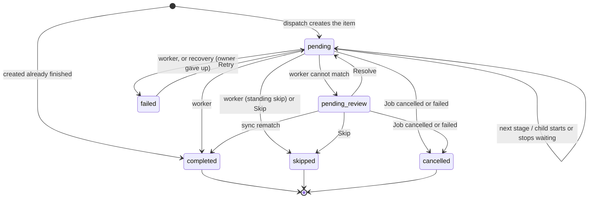
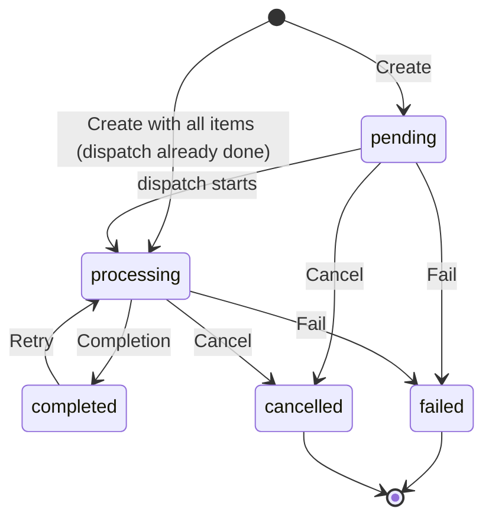

# Job lifecycle

How a **Job** and its **Job items** move from creation to a finished state, who is allowed to move them, and what must always be true along the way. Terms in bold are defined in [`GLOSSARY.md`](../GLOSSARY.md).

> **Status: target design.** This document describes how the lifecycle is meant to work. The code is being moved onto it one Job kind at a time (epic [#1265](https://github.com/drzero42/nexorious/issues/1265)). The table below says which kinds follow it today. Until a kind is listed as moved, its code is the authority for that kind, and `docs/sync.md` still describes the current sync behaviour.
>
> | Job kind | Follows this document |
> |---|---|
> | Metadata refresh | no |
> | Store-link refresh | no |
> | Export | no |
> | Generic import (registry sources, CSV) | no |
> | Nexorious import | no |
> | Sync | no |

## What the lifecycle guarantees

1. **No stuck Jobs.** Every Job either finishes or visibly waits on the user.
2. **Nothing finished is changed by accident.** A finished Job or item is never altered by a late or duplicate worker.
3. **User actions mean one thing.** Resolve, Skip, Retry and Cancel behave the same on every path and for every Job kind.
4. **Restarts are invisible.** A shutdown or crash never shows up as a failed or stuck Job.

Everything below exists to keep these four promises. When a change to the code is being considered, check it against the [invariants](#invariants); they are the test of whether the promises still hold.

## One owner

One package, `internal/joblifecycle` (the module), makes every change to `jobs.status`, `job_items.status` and `jobs.dispatch_complete`, and creates every Job and item. Workers, HTTP handlers and the scheduler ask the module for a transition; they never write these columns themselves.

Each Job kind registers with the module and tells it three things: which worker runs an item next, how to run the Job's dispatch again, and what its finishing effects are. The module does not import the workers.

## States

**Job**

| Status | Meaning |
|---|---|
| `pending` | Created; its dispatch has not started |
| `processing` | Its dispatch has started, or its items are being worked, or it waits on the user |
| `completed` | Finished: nothing is left for a worker or the user |
| `failed` | Finished by an error |
| `cancelled` | Finished by the user |

`pending` and `processing` are *active*. The other three are *finished*.

**Job item**

| Status | Meaning |
|---|---|
| `pending` | A worker acts next |
| `pending_review` | The user acts next (Resolve or Skip) |
| `completed` | Finished: the work was done |
| `failed` | Finished by an error; can be retried |
| `skipped` | Finished: the user, or a standing skip on the game, said not to do it |
| `cancelled` | Finished because its Job was cancelled or failed |

The status of an unfinished item only says who acts next. It never records a decision: the IGDB game chosen for an item is kept in `resolved_igdb_id`, so a resolved item is simply `pending` again.

`processing` remains a legal value of `job_items.status` for rows written by older versions. Nothing writes it any more. Recovery treats such a row as `pending`.

## Owners

Work on an item or on a dispatch is done by a River job. The lifecycle records which one:

- A `pending` item records the River job that **owns** it (`job_items.river_job_id`).
- A Job whose dispatch is not done records its dispatch River job the same way (`jobs.river_job_id`).

The owner is recorded in the same transaction that inserts the River job (see [ADR 0001](adr/0001-enqueue-river-jobs-in-the-status-transaction.md)). A worker may only write to an item it owns. A River retry of the same River job is still the owner; a second River job for the same item is not, and exits without doing anything.

There is one legal way for a `pending` item to have no owner: a [waiting child](#sync-parent-and-child-games).

## Item transitions

| From | To | Trigger | In the same transaction |
|---|---|---|---|
| (new) | `pending` | Dispatch | River job inserted and recorded as owner |
| (new) | `completed` | Dispatch | Nothing. Used for an item that carries data for a finishing effect (the nexorious import's pools) |
| `pending` | `pending` | The owning worker hands the item to its next stage | New River job inserted; it replaces the old owner |
| `pending` | `pending`, no owner | A sync child starts waiting on its parent | Owner cleared |
| `pending` | `pending_review` | The owning worker cannot match the item | Owner cleared; candidates stored; completion evaluated |
| `pending` | `completed`, `failed` or `skipped` | The owning worker | The worker's own result (see invariant 8); waiting children settled; completion evaluated |
| `pending_review` | `pending` | Resolve (imports) | Chosen IGDB game stored; River job inserted and recorded |
| `pending_review` | `completed` | Sync rematch of a game in Pending review | The library write itself (see [Outside the lifecycle](#outside-the-lifecycle)); completion evaluated |
| `pending_review` or `pending` | `skipped` | Skip | Owning River job cancelled, if any; waiting children skipped; completion evaluated |
| `failed` | `pending` | Retry | Job reopened if it was `completed`; River job inserted and recorded |
| `pending` or `pending_review` | `cancelled` | Cancel or Fail of the Job | Every River job of the Job cancelled |

No other item transition exists. In particular, nothing moves an item out of `completed`, `skipped` or `cancelled`.

## Job transitions

| From | To | Trigger | In the same transaction |
|---|---|---|---|
| (new) | `pending` | Create | Duplicate check under an advisory lock; dispatch River job inserted and recorded |
| (new) | `processing` | Create, when the creator inserts every item itself | Duplicate check under the lock; items and their River jobs inserted; dispatch marked done; completion evaluated |
| `pending` | `processing` | The dispatch starts | Refused when the Job is no longer active |
| active | `completed` | Completion (below). Never requested by a caller | Finishing effects queued |
| active | `failed` | Fail | Unfinished items cancelled; every River job of the Job cancelled; finishing effects queued |
| active | `cancelled` | Cancel | Unfinished items cancelled; every River job of the Job cancelled |
| `completed` | `processing` | Retry | The retried items' transitions |

A `failed` or `cancelled` Job is never reopened. Its dispatch may not have finished, so it could never complete; the user starts a new sync or import instead. Retry on such a Job is refused (HTTP 409).

## Completion

Completion is not an operation callers perform. The module evaluates it inside every transaction that changes an item or marks the dispatch done, with the Job row locked, so two items finishing at the same moment cannot both miss it.

The evaluation has three outcomes:

| Outcome | Condition | Effect |
|---|---|---|
| Still working | The dispatch is not done, or a `pending` item has an owner | None |
| Waiting on the user | The dispatch is done, no `pending` item has an owner, and at least one item is `pending_review` | The kind's *awaiting review* effect is queued (sync's needs-review notification). The Job stays `processing` |
| Completed | The dispatch is done and no item is `pending` or `pending_review` | The Job becomes `completed`; finishing effects are queued |

A `pending` item without an owner is a waiting child. It never decides the outcome on its own: its parent's item is unfinished in the same Job (invariant 3), so the parent's status does.

A Job waiting on the user stays `processing` for as long as it takes. For sync this means a storefront with games in **Pending review** does not start a new sync until they are resolved or skipped.

## Finishing effects

Notifications, the sync diff, metrics, the store-link refresh that follows a sync, and applying imported pools are *finishing effects*. They are not run inline. The transaction that completes or fails a Job inserts one River job that runs them, so a shutdown right after the transition cannot lose them.

Effects can run more than once (a River retry, or a Job that is retried and completes again), so each must be idempotent for its Job. Notifications already are, through their dedup key.

Cancel has no finishing effects.

## Invariants

1. Only the module writes Job or item status, and every write is conditional on the status it expects to find.
2. An item changes only while its Job is active. Retry reopens the Job first, in the same transaction.
3. A `pending` item has exactly one live River job, inserted by the transaction that made it `pending` and recorded on the item. The one exception is a child waiting on an unfinished parent item in the same Job.
4. A worker writes only to an item it owns.
5. Every item change locks the Job row and evaluates completion in the same transaction.
6. Finishing effects are queued in the transaction that finishes the Job, and are idempotent.
7. A finished Job has no unfinished items and no live River jobs.
8. A worker whose context is cancelled records nothing and returns the cancellation, and River runs the same River job again. A worker's real work and its item transition therefore commit in one transaction (the library write and its `changes` rows with the item's completion), or the work is safe to repeat.
9. An active Job whose dispatch is not done has exactly one live dispatch River job, recorded on the Job.

## Recovery

Recovery is one rule, with no time thresholds. It looks at every recorded owner:

| What it finds | What it does |
|---|---|
| A `pending` item whose owner was discarded by River (no attempts left) | The item is failed with a message saying so |
| A `pending` item whose owner no longer exists or ended any other way | A new River job is inserted for the item's next stage and recorded |
| An active Job whose dispatch is not done and whose dispatch River job was discarded | The Job is failed |
| An active Job whose dispatch is not done and whose dispatch River job no longer exists or ended any other way | The dispatch is inserted again and recorded |
| A `pending` item with no owner that is not a waiting child, or a `processing` item (both left by an older version) | It adopts the live River job that names it in its args, or is given a new one |

The rule runs periodically, and once at startup before River starts.

**Single instance.** Nexorious runs as one instance. At startup nothing else is working, so every River job still `running` belongs to a dead process. Before the rule runs at startup, each `running` River job that is an owner is released for retry if it has attempts left and discarded if it has none. The rule then deals with the discarded ones. Work that kills the process every time is therefore failed, not retried forever.

While the server runs, a `running` River job is alive, and the rule leaves its item alone.

## Job kinds

| Kind | Who creates the items | Item stages | Pending review | Finishing effects |
|---|---|---|---|---|
| Metadata refresh | The dispatch worker, all at once | One | No | None |
| Store-link refresh | The dispatch worker, all at once | One | No | None |
| Export | Has no items; its worker is its dispatch | None | No | Export completed / failed notification |
| Generic import | The upload handler, all at once | Match, then finalize | Yes | Import completed / failed notification |
| Nexorious import | The upload handler, all at once | One | No | Apply the imported pools; import completed / failed notification |
| Sync | The dispatch worker, in batches while it reads the library | Match, then write | Yes | On completion: sync completed (or completed with errors), sync diff, metrics, store-link refresh. On failure: sync failed or auth expired, credentials flag, metric. Awaiting review: needs-review notification |

A dispatch that is interrupted is never marked done. A dispatch only changes a Job that is still active.

### Sync: parent and child games

A **Child game** follows its parent's match. Its item can therefore be `pending` with no owner while it waits for the parent's item:

- A child waits only on an unfinished parent item **in the same Job**.
- Every way the parent's item can end settles its waiting children in the same transaction: parent completed, the children are queued and inherit its match; parent skipped, the children are skipped; parent failed, the children are failed.
- When the dispatch is marked done, a waiting child whose parent has no unfinished item in the Job is detached from the parent and queued for matching on its own. (The parent may have left the storefront library, or its item may be in a later batch than the child's; only at the end of the dispatch is it known which.)
- While the parent's item is in Pending review the children keep waiting. They do not stop the Job from counting as waiting on the user.

## Outside the lifecycle

- **Sync rematch and unskip are not Job work** (see [ADR 0002](adr/0002-rematch-and-unskip-are-not-job-work.md)). Rematch updates the library in its own transaction. It touches an item in one case only: when the game has an item in Pending review, that item and the items of its waiting children are completed in the same transaction. A rematch of a game whose item is `pending` in an active Job is refused (409), because a worker is about to write it. Unskip writes the library directly when the game is already matched; an unmatched game is picked up by the next sync.
- **The storefront view** shows a game as failed or in need of review from the game's newest item only, never from older items.
- **Deleting Jobs** (the 30-day cleanup, clear library, reset sync data, admin reset, deleting a user) removes rows outright. A worker whose item or Job is gone owns nothing and exits.
- **River jobs that are not tied to a Job** (the immediate metadata fetch, notification delivery, the periodic maintenance jobs) are not part of the lifecycle.
