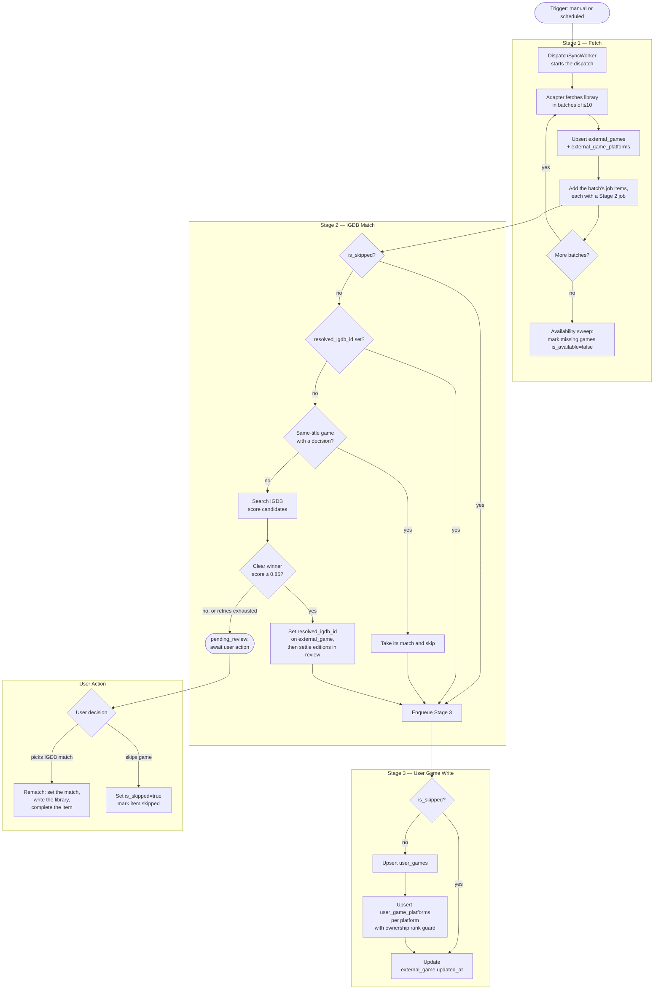

# Sync Process

This document is the source of truth for how Nexorious syncs a user's game library from an external storefront. It describes how the process **should** work. It is kept up to date as the process evolves and is intended for both humans and coding agents working on the sync system.

---

## Overview

Syncing imports a user's game library from an external storefront (Steam, PSN, GOG, Epic Games Store, Humble Bundle, or Amazon Games) into Nexorious. The process fetches the library, matches each game to an entry in the IGDB game database, and creates or updates the user's Nexorious library accordingly.

The sync pipeline is designed to be:

- **Consistent** — the same general process applies to all storefronts; per-storefront differences are isolated to adapter code
- **Resilient** — transient failures are retried automatically; anything the process cannot resolve on its own — whether from an API failure or an ambiguous match — is routed to the user without blocking the rest of the sync
- **Non-destructive** — ownership and playtime are never downgraded; existing data is only improved

---

## Glossary

| Term | Meaning |
|---|---|
| **Storefront** | An external game store: Steam, PSN, GOG, Epic Games Store, Humble Bundle, or Amazon Games |
| **ExternalGame** | A game record fetched from a storefront; persisted across sync runs |
| **ExternalGamePlatform** | A platform slug (e.g. `pc-windows`, `playstation-5`) that an ExternalGame is available on |
| **Job** | A sync run for one user and one storefront; tracks overall progress and status |
| **JobItem** | One game within a Job; tracks per-game matching progress |
| **IGDB** | The canonical game database used to identify and deduplicate games across storefronts |
| **pending_review** | A JobItem state where the user must manually pick an IGDB match or skip the game |
| **Ownership rank** | A hierarchy that prevents ownership downgrades: `owned` > `borrowed` / `rented` > `subscription` > `no_longer_owned` |

---

## Data Model

The sync system reads and writes these core tables:

| Table | Role |
|---|---|
| `user_sync_configs` | Credentials, sync frequency, and last sync timestamp per user and storefront |
| `external_games` | One row per user + storefront + game; persists across sync runs. Which games are editions of each other is not stored (see [Editions](#editions)). `store_link` (nullable) holds the product-page identifier written by store-link enrichment; `source_metadata` (jsonb, nullable) captures per-source resolution inputs (e.g. Epic's namespace) at Stage 1. `library_written_at` (nullable) is set by the library write only, and lets the storefront view ignore items older than the last write (see [The storefront view](#the-storefront-view)) |
| `external_game_platforms` | Platform slugs and per-platform playtime for each ExternalGame |
| `jobs` | One row per sync run; tracks status and lifecycle |
| `job_items` | One row per game per sync run; tracks matching progress |
| `sync_changes` | Changelog entries written by Stage 1 and Stage 3; backs the Sync History UI |
| `games` | IGDB master catalogue; new rows are inserted when a match is found |
| `user_games` | The user's canonical library; one row per user + IGDB game |
| `user_game_platforms` | One row per user + game + platform + storefront combination |

### Key relationships

`user_games` holds one row per user per IGDB game, regardless of how many storefronts or platforms the game was found on. Each `user_game_platforms` row points back to the specific `external_games` row that created it via `external_game_id`. This means a single `user_games` row can have multiple `user_game_platforms` rows pointing to different `external_games` rows — which is expected and correct for storefronts that create multiple ExternalGame rows for the same game.

For example, PSN creates one ExternalGame row per title ID. The PS4 and PS5 versions of the same game are separate title IDs, so they produce separate ExternalGame rows and separate `user_game_platforms` rows — but both point to the same `user_games` row.

### Playtime

Playtime is stored at the `external_game_platforms` level (`hours_played`). Stage 1 writes the correct value to each platform row as part of the upsert; Stage 3 reads from there when writing to `user_game_platforms`. The total playtime for a game in the user's library is the sum of `hours_played` across all its `user_game_platforms` rows.

Not all storefronts provide playtime. When a storefront does not provide playtime, `hours_played` is 0 for all platform rows. Playtime is never decreased — a `user_game_platforms` row's `hours_played` is only updated when the incoming value is greater than the stored value.

### Sync Changes

`sync_changes` records what happened to a user's library during each sync run. Each row captures one event:

| Column | Type | Notes |
|---|---|---|
| `id` | TEXT | Primary key |
| `job_id` | TEXT | The sync job that produced this change; FK to `jobs` |
| `user_id` | TEXT | FK to `users` |
| `external_game_id` | TEXT | FK to `external_games`; nullable (SET NULL on delete) |
| `change_type` | TEXT | `added`, `removed`, or `status_changed` |
| `title` | TEXT | Game title at the time of the event; denormalised for display |
| `old_status` | TEXT | Previous ownership status; only set for `status_changed` |
| `new_status` | TEXT | New ownership status; only set for `status_changed` |
| `created_at` | TIMESTAMPTZ | When the event was recorded |

Writers:
- **Stage 1** writes a `removed` entry for each game marked `is_available = false` during the availability sweep
- **Stage 3** writes an `added` entry when a new `user_games` row is inserted, and a `status_changed` entry when the ownership rank guard replaces an existing status

Old entries are pruned by a periodic maintenance job (see Maintenance).

---

## Architecture

The sync pipeline has three stages. Each stage is implemented as a River worker job in the `tasks` package. The `DispatchSyncWorker` defines a standard adapter interface; each storefront implements that interface in its own `services/` package (`services/steam`, `services/playstationstore`, `services/gog`, `services/epicgamesstore`, `services/humble`). Storefront-specific knowledge — auth, API communication, credential lifecycle — never crosses into the workers.



Every change to the status of a sync Job or job item goes through the Job lifecycle module (`internal/joblifecycle`); [docs/job-lifecycle.md](job-lifecycle.md) is its specification. This document describes what is particular to sync.

### DispatchSyncWorker responsibilities

The `DispatchSyncWorker` is the dispatch owner of its Job.

- Starting the dispatch through the module; it is refused, and exits, when the Job is no longer active or the dispatch is already done
- Calling the adapter's batch callback and iterating until the library is fully fetched
- Upserting `external_games` and `external_game_platforms` after each batch, only while the Job is active
- Adding each batch's job items, with their Stage 2 River jobs, through the module
- Running the sweeps at the end of the fetch phase
- Marking the dispatch done, with `last_synced_at`
- Failing the Job through the module on a credential error or any other failure

### Storefront adapter responsibilities

Each adapter lives in its own `services/` package and is responsible for:

- All authentication mechanics (token refresh, CLI state management, credential expiry detection)
- Signalling credential errors to the worker
- Yielding games in batches of ≤10 via a callback

### Adapter interface

The `tasks` package defines a concrete Go interface (`StorefrontAdapter`) that every storefront adapter must implement. Each `services/` package implements this interface; the `DispatchSyncWorker` depends only on the interface, never on a concrete adapter type.

The interface requires a `GetLibrary` method that accepts a context, a batch size, and a callback. The adapter calls the callback once per batch of ≤10 games, each represented by a `GameEntry` value with the following fields:

| Field | Type | Notes |
|---|---|---|
| `ExternalID` | string | Storefront-specific game identifier |
| `Title` | string | Game name as reported by the storefront |
| `PlaytimeHours` | int | Hours played; 0 means not provided by this storefront |
| `Platforms` | []string | Platform names in storefront-specific format; resolved to canonical slugs by the worker |
| `OwnershipStatus` | string | `owned`, `subscription`, etc. |
| `IsSubscription` | bool | True if the game is accessed via a subscription service |
| `SourceMetadata` | map[string]string | Optional per-source resolution inputs captured for later store-link enrichment (currently only Epic sets `{"namespace": …}`); persisted to `external_games.source_metadata`. Never used to build the link directly |

---

## Stage 1 — Fetch

The `DispatchSyncWorker` runs once per sync job. It:

1. Starts the dispatch
2. Calls the storefront adapter which fetches the library and yields games in batches of ≤10
3. After each batch:
   - Writes each game in a short transaction that first takes a share lock on the Job row and stops the dispatch if the Job is no longer active (a Cancel, or a reset of the storefront's sync data). In it the game is upserted into `external_games` (`updated_at = now()`, `is_available = true`), its platform rows into `external_game_platforms`, and a skipped game's `skipped` change. These writes are best effort: one that fails is logged and the game is written by the next sync
   - Accumulates each game's `external_id` into an in-memory set of fetched IDs
   - Adds a job item for every game that is not skipped, with its Stage 2 River job, in one transaction through the module. A game the Job already has an item for gets none, so a dispatch that runs again gives no item a second River job. A skipped game gets no job item, only a `skipped` change. A new game gets no decision here, also when it is an edition of a skipped game: its item takes the skip in Stage 2 (see [Editions](#editions))
   - A database error while adding the items is returned to River, which runs the dispatch again; it does not fail the sync
4. After all batches complete, the sweeps run: platform rows not seen in this fetch are removed, and every `external_games` row for this user and storefront still marked available whose `external_id` was not fetched is marked `is_available = false` with a `removed` entry in `sync_changes`. Each game is one transaction (Job row share lock, then the game, then the `removed` row only when this run changed it), so a sweep that runs twice writes one row.
   The sweep is skipped when the fetch returned no games at all while at least one game is still marked available for this storefront. An empty reply is far more likely a privacy setting, an upstream glitch or a changed response shape than a library that really went to zero, so the job fails instead (`sync.failed`) and nothing is marked removed. If the library really is empty, reset the storefront's sync data or disconnect it.

5. Marks the dispatch done, with `last_synced_at` and the cleared credentials flag in the same transaction. The module then evaluates completion; an empty library completes here.

The dispatch checks its context as soon as the fetch returns, whatever the fetch returned: a fetch cut off by a shutdown or a Cancel can return with a partial library and no error, or with an error that is not the storefront's answer (an authentication error from a cancelled request). Such a dispatch records nothing; it is not failed, no sweep runs and it is not marked done.

If a credential error occurs, the Job is failed (its open items cancelled) and `credentials_error` is set in the same transaction. Any `external_games` rows already upserted in this run are kept.

The dispatch has a two-hour timeout. One that exceeds it is cancelled, uses an attempt and runs again; after its last attempt recovery fails the sync.

---

## Stage 2 — IGDB Match

One `IGDBMatchWorker` job runs per game. River handles retries with exponential backoff for transient IGDB API failures.

1. **Skipped?** If `is_skipped` is true, route directly to Stage 3 — no matching is ever performed for skipped games
2. **Already resolved?** If `resolved_igdb_id` is set from a previous sync run, route directly to Stage 3. On subsequent syncs, most games will take this path
3. **Precedent.** If a same-title game (same user, storefront and title) has a decision, the game takes the match and the skip of the oldest such game and routes to Stage 3 without a search (see [Editions](#editions))
4. **Search IGDB** for the game title; score each candidate using fuzzy title matching
5. **Auto-resolve** if the best candidate scores ≥ 0.85 and has a clear margin (> 0.01) over the second-best: set `resolved_igdb_id` on the `external_game` and enqueue Stage 3, then settle the game's editions waiting in review (see [Editions](#editions)). A same-title game decided during the search wins over the search result
6. **pending_review** if no clear winner is found, or if IGDB API calls fail after all River retries are exhausted: mark the item `pending_review` for the user to resolve, unless the game has a decision by then (a rematch, or a same-title game it can take a decision from)

### Title matching

Before searching, titles are normalised (trademark symbols removed, diacritics folded, common suffixes like "GOTY" expanded, etc.). Candidates are scored using a weighted combination of fuzzy matching algorithms. The auto-resolve threshold is 0.85 with a tie-breaking margin of 0.01.

### Editions

Some storefronts give the platform releases of one game separate identifiers: PSN gives the PS4 and PS5 versions of a game distinct title IDs. Each arrives as its own `external_games` row. The **editions** of an External game are the External games of the same user and storefront that have the same title, the same match (`resolved_igdb_id`) and the same skip (`is_skipped`). Nothing stores this: two games are editions for as long as they agree, and stop being editions when they differ. Every edition has its own match, its own skip and its own job item. The key is defined once, in `internal/externalgame` (`SameEdition`, `EditionKey`), and the lock, the storefront list, the review badge and the lookup of a set's open items are all built from it ([ADR 0008](adr/0008-derived-editions.md)).

Four rules make editions behave as one game:

1. **Precedent (Stage 2).** A game without a decision (unmatched and not skipped) takes the match and the skip of the oldest same-title game that has one (`created_at`, then id), and is not searched. The copy is made once; afterwards the game stands on its own. A same-title game on another storefront decides nothing, nor does one without a decision. The other game is read `FOR SHARE`, so a Rematch, Skip or Unskip in progress on it is waited for. Precedent applies whenever a game has no decision, not only when it is new, so an undecided game beside a decided one takes the decision at the next sync. A new edition of a skipped game gets a job item and takes the skip when its match worker runs; its item then ends `skipped` and nothing is written. If the Job fails or is cancelled in between, the game shows as its own unmatched entry until the next sync gives it the skip.
2. **Fan-out.** Rematch, Skip and Unskip act on every edition of the game they are given, through any edition's id, and lock the editions in id order (see [User Interactions](#user-interactions)).
3. **One row.** The storefront list and the review badge show a set of editions as one entry (see [The storefront view](#the-storefront-view)).
4. **Settle (Stage 2).** Two editions are searched with different platform filters, so one can match with confidence while the other goes to review. When a search matches a game with confidence, its same-title games of that sync waiting in Pending review without a decision take that match by precedent, are written to the library, and their items are completed, in the Job lifecycle module's transaction for the Job. Settle only gives a match: when the oldest decision of the title is a skip, the game is left as it is and its item stays in review. Settle is best effort: it runs after the matched edition's transition has committed, and a failure is logged and leaves the items in review.

Two undecided editions searched in the same sync both end in Pending review if neither search is confident: one entry in the list, and one Rematch completes both items.

**Locking a game's editions** (`externalgame.LockEditions`). The game's state is read without a lock, the set is locked `FOR UPDATE` in id order by that state, and the set's ids are read again in a new statement. The lock holds when the game is in the locked set and the second read gives exactly the locked ids; otherwise the try is rolled back (it runs in a savepoint) and repeated, up to three times, after which the request is answered with 409 and a message to try again. The second read catches a decision that committed in between, and an edition a match worker added by taking precedent from a locked game while the lock waited for it. Once the set is locked, no further edition can join by precedent. Two other ways into or out of a set are not closed and are accepted: the dispatch rewrites a game's title at every sync without this lock, and another Rematch can move a same-title game onto the same match; either is the same as that change arriving just after the decision.

Both item workers act only on an item whose recorded River job they are, so a late or duplicate River job, or one run again after its result committed, writes nothing.

---

## Stage 3 — User Game Write

One `UserGameWorker` job runs per game, handed on by Stage 2.

1. If `is_skipped` is true: record a `skipped` change and finish the item as `skipped`, in one transaction, and stop
2. In one transaction, after the module checked that this River job still owns the item, the **library write** (`externalgame.WriteToLibrary`, shared with rematch and unskip), the item's `sync_changes` rows and the item's completion:
   - Lock the `external_games` row (`FOR UPDATE`) and read `resolved_igdb_id` and `is_skipped` again under the lock. A writer that loaded the game before a rematch committed writes the rematch's match, never the old one; a game skipped meanwhile is handled as in step 1
   - Ensure the `games` row, then `usergame.Acquire` (`ModeUpsert`) on every row in `external_game_platforms`: one `user_games` row per user + IGDB game ID, and one `user_game_platforms` row per `(user_game_id, platform, storefront)` with `external_game_id` set. On conflict the ownership rank guard applies (never downgrade ownership status), and `hours_played` is updated only if the incoming value is greater
   - Set `external_games.updated_at` and `library_written_at`
   - Write `added` (new user game), `status_changed` (ownership upgrade) or `already_in_library` to `sync_changes`
   - A game with no match, no platform rows, or that `Acquire` refuses fails the item. A database error is returned to River, which retries; on the last attempt the item fails with it
3. After commit, if IGDB is configured and the `games` row has no description, an immediate metadata fetch is enqueued for that game. This ensures newly added games have cover art and full IGDB data within seconds rather than waiting for the next scheduled bulk refresh. The enqueue is fire-and-forget and non-fatal — the periodic bulk refresh (see [docs/maintenance.md](maintenance.md) § "Metadata refresh") remains the safety net.

Stage 2 never overwrites a decision: its writes of `resolved_igdb_id` (a confident search result, a decision taken by precedent) apply only while the game has none, so a rematch that commits during an IGDB search wins. An item goes to `pending_review` only in a transaction that first tries to take precedent and then reads the game `FOR SHARE` and finds it still unmatched; otherwise the item goes on to Stage 3.

### Play Status

`user_games.play_status` defaults to `'not_started'`. Sync infers an initial status from the incoming hours:

- If total `hours_played` across all `external_game_platforms` rows for the game is **> 0**, and the current `play_status` is `'not_started'` (either because the row is new, or because it was previously unplayed), sync sets `play_status = 'in_progress'`.
- If total hours = 0, the DB default (`'not_started'`) applies and nothing is changed.

Sync can only auto-promote `not_started → in_progress`. Any other status the user has explicitly set (e.g. `'completed'`, `'on_hold'`) is never touched by sync.

Manually added games that omit `play_status` default to `'not_started'` via the DB default. The sync worker applies the same inference when it later processes that game from a storefront.

### Ownership rank guard

Ownership statuses have a fixed rank. A stored status is never replaced by one of lower rank:

```
owned  >  borrowed / rented  >  subscription  >  no_longer_owned
```

### Manually added games

A user may add a game to their library by hand and associate it with a platform and storefront before that storefront has ever been synced. When Stage 3 later processes the same game from a sync run, it encounters an existing `user_game_platforms` row with a matching `(user_game_id, platform, storefront)` key. The behaviour is identical to any other conflict: the ownership rank guard applies and playtime is updated only if the incoming value is higher.

Additionally, a manually added row has no `external_game_id` because it was not produced by a sync. Stage 3 fills this in: `external_game_id` is always set (or updated) to the `external_games` row that produced the platform entry, so the association is linked to the storefront record from that point forward.

---

## Job Lifecycle

Sync Jobs and their job items follow [docs/job-lifecycle.md](job-lifecycle.md): its states, transitions, recovery, and what happens on a shutdown or restart. A sync interrupted by a shutdown resumes at the next startup. A sync waiting on the user (items in Pending review) stays `processing` until they are resolved or skipped, and the storefront does not start a new sync meanwhile.

The sync kind's ending effects are `sync.completed` (or `sync.completed_with_errors`), `sync.diff` and the store-link refresh for the storefront when it completes; `sync.failed` or `sync.auth_expired` when it fails; and `sync.needs_review` when it starts waiting on the user. `sync.recovered` is not an ending effect: the dispatch sends it when it marks a successful fetch, in the same transaction that writes `last_synced_at` (see [Scheduled Sync](#scheduled-sync)).

---

## User Interactions

Rematch and unskip are edits to one game and its editions, not sync work ([ADR 0002](adr/0002-rematch-and-unskip-are-not-job-work.md)). They write the library in the request's own transaction, using the same library write as Stage 3, and create no Job, no job item and no River job. They are complete when the request returns. Rematch, Skip and Unskip act on every edition of the game, through any edition's id (see [Editions](#editions)); a missing game is 404, and a set that kept changing while it was being locked is 409.

### Matching or rematching a game

The user searches IGDB and picks a match, for a game in review, an unmatched game, or a matched game whose match is wrong. `HandleRematchExternalGame` first looks, without a lock, for an active Job in which the game or one of its editions has an open item, preferring the Job of the game's own item. If there is one, everything below runs in the Job lifecycle module's transaction for that Job, with the Job row locked first, as a sync worker does. In one transaction:

1. Locks the game's editions, in id order.
2. Refuses with 409 `a sync is still working on this game` while the game's **own** item is `pending` in that Job: the sync has not finished with it.
3. Removes the platform links of every edition. Every user game this leaves with no links from outside the set is orphaned, except the user game of the new match: without `orphan_action` the request is refused with 409 `orphan_action required`; `keep` keeps them, `remove` deletes them.
4. Sets the match on every edition and clears `is_skipped` on them.
5. Writes each edition to the library. One with no platform rows is not written; the match is still recorded.
6. Completes, in that Job, every open item of the set (the game's own one is in Pending review by step 2), cancelling their River jobs. For each it writes the `sync_changes` rows the worker would have (`added` at most once, when a write created the user game). A worker of another edition that was running is refused before it writes.

Items in a Job that is not active are left alone, and a rematch outside an active sync writes no `sync_changes`. The immediate metadata fetch is queued after commit.

### Skipping a game

The user Skips a game. `is_skipped` is set to `true` on every edition. When the game or an edition has an open item in an active Job, this runs in the Job lifecycle module's transaction for each such Job: those items become `skipped`, a River job working on one is cancelled, and the game's `skipped` change is written when its own item was skipped. Otherwise only the flags are set. On future syncs the dispatch creates no job item for a skipped game and records a `skipped` change instead. A new edition of a skipped game that appears later gets an item, which takes the skip in Stage 2 and ends `skipped` (see [Editions](#editions)).

### Unskipping a game

The user removes the skip. In one transaction `HandleUnskipGame` locks the game's editions, clears `is_skipped` on them and, if they are matched, writes each to the library. Editions have one match by definition. Unmatched ones are not written: the set shows as **Unmatched**, where the user can match it; the next sync matches it if it is still in the storefront library. Unskip has no Job lookup and touches no items.

### Retrying failed games

"Retry all" on a storefront retries every External game whose newest item failed by the view's rule, each edition on its own. The items are retried through the module, per Job, newest Job first. An item whose Job cannot be retried is left as it is: a `failed` or `cancelled` Job is never reopened, and a `completed` one is not reopened while another sync of the storefront is active (including one this request has just reopened). The endpoint answers 204 either way.

### The storefront view

The External Games list reads a game's status from its **newest** item (`ORDER BY created_at DESC, id DESC`), and only while nothing has written the game to the library since (`library_written_at`). Older items are history.

- **needs_review**: the newest item is `pending_review` and was created after the last write, or any item of the game is `pending_review` in an active Job (an older Job reopened by a retry, which blocks new syncs until the game is reviewed).
- **skipped** comes next: a skipped game whose newest item failed shows as skipped, where it can be unskipped.
- **failed**: the newest item failed after the last write. `failed_job_item_id` is that item while its Job is active or `completed`, so Retry can work; it is null otherwise, and null unless the game shows as failed.
- **matched** / **unmatched** otherwise.
- A game is hidden while its newest item is `pending` in an active Job: a sync worker still acts on it. No item is left open in an ended Job.

The list has **one entry per set of editions**. Each edition's status comes from its own newest item by the rules above; the entry needs review, has failed, or is hidden as in flight when any edition does. The entry is its representative: the oldest edition still in the storefront library, else the oldest. It is available when any edition is, and its platforms are those of all editions. `failed_job_item_id` is the newest item of the first retryable edition, only while the entry shows as failed; retrying it leaves a second failed edition showing as failed, and "Retry all" retries them all.

The orphan fields (`has_user_game`, `user_game_id`, `user_game_other_platform_count`) are per set, with the same definition as the rematch's orphan check: links of any edition, "other" meaning outside the set. The pending-review badge counts sync review per set of editions: a set counts when any edition needs review and none is in flight. `GET /api/sync/ignored` and the sync status count still show one entry per edition (#1438).

---

## Credential Errors

All storefronts expose credential problems through a unified `credentials_error` flag in their status response. Each storefront detects errors differently, but all surface them the same way to the worker:

| Storefront | Detection mechanism |
|---|---|
| **Steam** | Decryption failure of `storefront_credentials`, or API key rejected by the Steam API |
| **PSN** | Authentication failure when exchanging the NPSSO token for an access token (token expires approximately every 2 months) |
| **GOG** | OAuth2 refresh token failure (refresh token expired or revoked) |
| **Epic** | Decryption failure of `storefront_credentials`, or Legendary CLI reports an authentication failure |
| **Humble Bundle** | Decryption failure of `storefront_credentials`, or the order API rejects the `_simpleauth_sess` session cookie (401/403); the cookie expires periodically and must be re-pasted |
| **Amazon Games** | Decryption failure of `storefront_credentials`, or nile reports Amazon refused the refresh token (a 4xx on token refresh) or finds no signed-in user |

When a credential error occurs mid-sync, the job is marked `failed` and all pending job_items are cancelled. The user must reconfigure their credentials before triggering a new sync.

A credentials error belongs to the stored sign-in the sync loaded. `credentials_error` is set, and the expiry notification sent, only when that sign-in is still stored, checked in the same `UPDATE` that sets the flag, so reconnecting while a sync runs never gets the new sign-in marked expired. This covers a failure while building the adapter (no stored sign-in, or one that does not decrypt) for every storefront, and a failure during the fetch for Steam, PSN, GOG and Humble Bundle. Epic is the exception for the fetch: its adapter rewrites its snapshot on every run, so its fetch failures flag the storefront unconditionally. The flag and its notification are saved in one transaction, so neither is left without the other, and both are written before the job is marked failed, so a page that refreshes the connection when it sees the job end already finds it. The other way round holds too: a GOG token or Epic snapshot the sync refreshed is saved only while the stored sign-in is still the one the sync read or last wrote, so a reconnect is never overwritten by the older sign-in.

Credentials are stored encrypted at rest in `user_sync_configs.storefront_credentials`. Decryption happens in memory during Stage 1 only; plaintext is never persisted. On decryption failure, the encrypted bytes are left untouched in the database — they are never cleared.

---

## Store-Link Enrichment

The game details page renders each storefront a game is associated with as a deep-link to that game's product page on that store. The link target is resolved by a dedicated background worker, decoupled from the sync pipeline so sync never blocks on per-game store lookups.

### Storage & URL model

A single `external_games.store_link` column holds whatever a store needs to build its product URL — always the same column for every storefront, holding a slug or an ID depending on the store. A pure URL-builder in the API layer (`internal/api/store_url.go`, `buildStoreURL`) turns `(storefront, store_link)` into the product URL when serving the game details endpoint, reading only `store_link`. URL formats live in code, so a store changing its scheme is a code fix, not a re-sync. A storefront is rendered as a link iff the builder returns a URL; otherwise it stays a plain label.

| Storefront | `store_link` holds | URL |
|---|---|---|
| `steam` | appid | `https://store.steampowered.com/app/{store_link}/` |
| `gog` | product slug | `https://www.gog.com/game/{store_link}` |
| `epic-games-store` | product slug | `https://store.epicgames.com/en-US/p/{store_link}` |
| `playstation-store` | concept ID | `https://store.playstation.com/en-us/concept/{store_link}` |
| `humble-bundle` | — (always null) | no link |
| `amazon-games` | — (always null) | no link |

### Ownership: enrichment is the sole writer

`store_link` is written **only** by the enrichment worker; the sync upsert (Stage 1) never touches it, so a re-sync can never null a resolved link. Sync's only contribution is capturing resolution *inputs*: the Epic adapter records its `namespace` into `external_games.source_metadata` (Epic's `productmapping` is keyed by namespace, which is not derivable from `external_id` alone). The other stores resolve from `external_id` directly.

### Workers

Modelled on the metadata-refresh pattern (a dispatch + item worker pair, in `internal/worker/tasks/store_link_refresh.go`):

- **`StoreLinkRefreshDispatchWorker`** selects the distinct `(user, storefront)` groups needing work from `external_games` (restricted to the resolvable storefronts), creates a `jobs` row plus **one `job_item` per group**, and enqueues a per-group item job. A scoped active-job guard prevents a duplicate pass for the same scope (a Steam sync finishing never blocks a GOG enrichment).
  - `Force = false` (incremental): only rows where `store_link IS NULL`.
  - `Force = true`: re-resolves every row from upstream (the "fix stale/broken links" pass).
- **`StoreLinkRefreshItemWorker`** resolves the rows for its one `(user, storefront)` group, amortising shared setup once per group (Epic's `productmapping` fetch; PSN authentication). Resolution is **best-effort**: a failed or empty lookup leaves `store_link` null and never fails the job. Per-storefront resolvers live in `internal/services/storelink` (Steam copies the appid; GOG hits the public `api.gog.com/products/{id}`; Epic looks up the captured namespace in `productmapping`; PSN resolves a concept ID via the catalog API using the user's NPSSO).

### Triggers

Enrichment is **event-driven, never periodic**:

- **Sync completion** — when a sync job completes, its ending effect queues a **scoped, incremental** dispatch (`Force = false`) for that job's storefront only. New/changed games get links shortly after their sync.
- **Admin maintenance** — `POST /api/games/store-links/refresh-job` (admin-only; the "Refresh store links" button on the maintenance page) enqueues a **global, forced** dispatch (`Force = true`) that re-resolves every resolvable row from upstream.

Storefront associations created outside sync (e.g. CSV import onto non-sync stores) have no resolver and render no link. Existing rows show no link until their storefront re-syncs (or an admin runs the manual refresh); there is no migration-time backfill.

---

## Scheduled Sync

A periodic worker checks `user_sync_configs` for all users where the sync frequency is not `manual` and the last sync was more than the configured interval ago (hourly / daily / weekly). For each, it creates a Job and enqueues a Stage 1 run — provided no active job already exists for that user and storefront. All six storefronts support scheduled sync.

After a failed sync the next scheduled one waits: 15 minutes after the newest failure, doubled for each further failure since the last successful fetch (manual and credential failures count too), and never longer than the sync interval. A failed lookup of that history never holds a sync back.

Only the first failure since the last successful fetch sends `sync.failed`; later ones are logged and stay quiet, whatever their message, so one outage sends one notice. Credential failures are not counted for this, since they send their own notice (see [Credential errors](#credential-errors)) only on the change into the error state.

The first successful fetch after such an outage sends `sync.recovered`, so the user learns the outage is over. Both rules measure the outage from the store's last successful fetch, which Reset sync data leaves alone: a reset neither hides a new outage nor reports the end of one that was never notified. A store that failed only for its credentials sent no `sync.failed`, and the user's reconnect ended it, so its recovery sends nothing.

---

## Maintenance

Maintenance tasks that support the sync system, such as sync history pruning, are documented in [docs/maintenance.md](maintenance.md). Interrupted sync work is recovered by the Job lifecycle module's recovery rule (see [docs/job-lifecycle.md](job-lifecycle.md#recovery)).

An admin can also trigger a global store-link refresh (re-resolving every storefront product link from upstream) from the maintenance page; see [Store-Link Enrichment](#store-link-enrichment).

---

## Storefront Adapters

All adapters implement the same interface. The differences below are the only places where storefront-specific knowledge lives.

### Steam

- **Auth:** API key + Steam ID; static credentials, no refresh needed
- **Library fetch:** A single API call returns the full library. The adapter then makes one AppDetails API call per game to resolve platform availability, and chunks the enriched results into batches of ≤10 before yielding them via the callback. The batching is adapter-side; the Steam API itself is not paginated
- **Rate limiting:** A token bucket enforces a minimum delay between AppDetails calls. On a 429 response, the adapter backs off and retries. Rate limiting is handled consistently with the shared library's backoff interface
- **Platforms:** `pc-windows`, `mac`, `pc-linux` as reported by AppDetails; all supported platforms are recorded as separate `external_game_platforms` rows
- **Playtime:** Provided as a single total across all platforms. The adapter assigns this value to the `hours_played` of the highest-priority platform row in the order `pc-windows` → `mac` → `pc-linux`; all other platform rows for the same game receive 0
- **Achievements:** For games with playtime > 0 the adapter fetches per-game achievement stats and records `achievements_unlocked` and `achievements_total` on the `user_game_platforms` row; games with no playtime or no achievement schema leave both fields null
- **Store link:** `store_link` is the appid (the same value as `external_id`); enrichment copies it directly, no API call

### PSN

- **Auth:** NPSSO token exchanged for an access token; token expiry is detected and surfaced as a credential error
- **Library fetch:** Paginated API; the adapter re-chunks pages into batches of ≤10 for the callback
- **Rate limiting:** No published hard limit; the adapter applies a conservative request delay between pages
- **Platforms:** Derived from the `category` field in the API response — `ps4_game` maps to `playstation-4`, `ps5_native_game` maps to `playstation-5`. PSN creates one ExternalGame row per title ID, so the PS4 and PS5 versions of the same game appear as two separate ExternalGame rows, each with their own platform and playtime
- **Playtime:** Provided per title ID as an ISO 8601 duration string, parsed to hours
- **Store link:** `store_link` is a store concept ID; enrichment resolves it from the title ID via the catalog API (`GET /api/catalog/v2/titles/{titleId}/concepts`) using the user's NPSSO. Titles with no resolvable concept stay null

### GOG

- **Auth:** OAuth2; the adapter refreshes the access token using the stored refresh token before each fetch and saves the new tokens back to `user_sync_configs`
- **Library fetch:** Paginated API; the adapter re-chunks pages into batches of ≤10
- **Rate limiting:** Conservative request delay between pages
- **Platforms:** Reported per entry; mapped to canonical slugs
- **Playtime:** Not provided by the GOG API; always 0
- **Store link:** `store_link` is the product slug; enrichment resolves it from the numeric product id via the public `GET https://api.gog.com/products/{id}` endpoint (no auth — separate from the OAuth library fetch)

### Epic Games Store

- **Prerequisites:** Requires the `LEGENDARY_WORK_DIR` environment variable to be set to a writable directory. If unset, Epic sync is disabled entirely — the adapter returns an error immediately and the storefront is unavailable in the UI
- **Auth:** Managed by the Legendary CLI. Each sign-in and sync runs in its own fresh directory under `LEGENDARY_WORK_DIR`, removed when it finishes (one left behind by a crash is removed at the next startup once it is over an hour old). A sync restores the encrypted session state snapshot from `user_sync_configs.storefront_credentials` into it, runs the CLI, then captures and re-encrypts the updated snapshot back to `storefront_credentials` — only if the stored sign-in is still the one the sync loaded, so a disconnect or reconnect during the sync wins
- **Library fetch:** `legendary list --json`; DLC entries are filtered out (identified by a non-empty `MainGameAppName`); the adapter chunks the output into batches of ≤10
- **Rate limiting:** Handled internally by the Legendary CLI
- **Platforms:** Epic does not expose per-game platform data; all entries are `pc-windows`
- **Playtime:** Not provided; always 0
- **Store link:** `store_link` is the product slug. The adapter captures each entry's `namespace` into `source_metadata` at Stage 1; enrichment looks that namespace up in the public `productmapping` dictionary (`GET https://store-content-ipv4.ak.epicgames.com/api/content/productmapping`, fetched once per group). Namespaces absent from the mapping stay null

### Humble Bundle

- **Auth:** A `_simpleauth_sess` session cookie, pasted by the user (programmatic login is gated by reCAPTCHA + 2FA, so server-side login is not viable). The cookie is verified on save against the order API and stored encrypted; expiry is surfaced as a credential error and prompts a re-paste
- **Library fetch:** Lists order gamekeys (`GET /api/v1/user/order`), then fetches each order's detail (`GET /api/v1/order/{gamekey}?all_tpkds=true`). A single failing order is logged and skipped so one bad order doesn't sink the sync. Qualifying subproducts are yielded in batches of ≤10
- **DRM-free only:** Only games the user can download directly from Humble are imported. A subproduct is a game iff it has a download whose platform is in the whitelist `{windows, mac, linux, android}` with a non-empty `download_struct[0].url.web`, and its `machine_name` is not in the launcher blocklist (`uplayclient`). Ebooks, audio, video, `asmjs`, and promo/info stubs are excluded by absence of a game-platform download. **Third-party keys (`tpkd_dict`) are never read**, so Steam-key-only titles are not imported
- **Rate limiting:** Conservative request delay (5 req/sec) between API calls
- **Platforms:** Mapped in-adapter — `windows`→`pc-windows`, `mac`→`mac`, `linux`→`pc-linux`, `android`→`android` (union across a subproduct's qualifying downloads). PC and Android editions are separate subproducts (distinct `machine_name`, shared title); the adapter emits both and the pipeline collapses them into one library entry with the union of platforms
- **Playtime:** Not provided by Humble; always 0
- **Store link:** none — there is no reliable public per-game store URL for the items ingested; `store_link` stays null and no link is rendered

### Amazon Games

- **Prerequisites:** The `nile` CLI (v1.2.0 or newer, from [imLinguin/nile](https://github.com/imLinguin/nile), the Amazon Games client Heroic uses) on the server's `PATH`. It is bundled in the container image. Without it Amazon sync is disabled: the connection endpoint reports `disabled` with reason `nile_not_installed`
- **Auth:** Two steps. `POST /api/sync/amazon-games/connection/login` runs `nile auth --login --non-interactive`, which generates a device serial, client id and PKCE code verifier, and returns only the Amazon sign-in URL and an `attempt_id`: those three values, the user id and an expiry 15 minutes out, encrypted with the server's `DB_ENCRYPTION_KEY` (`crypto.Encrypter`), so nothing is kept server-side and any replica sharing the key can finish the sign-in, before or after a restart. The user signs in and pastes the amazon.com address they land on (or the bare `openid.oa2.authorization_code`) to `PUT /api/sync/amazon-games/connection`, which decrypts the attempt, checks it belongs to the caller and has not expired, runs `nile register` and stores nile's user data (device registration and tokens) encrypted in `storefront_credentials`. An attempt that does not decrypt, belongs to another user or has expired is a 409. Starting again does not cancel an earlier attempt; whichever finishes last is the stored sign-in
- **Disconnect:** `DELETE /api/sync/amazon-games/connection` removes the stored sign-in and returns, then runs `nile auth --logout` with the removed sign-in in a temporary `NILE_CONFIG_PATH` (20-second limit) to deregister that device from the Amazon account. The sign-out is best effort: a failure is logged at warn and the disconnect has still succeeded. Without nile on the server the connection endpoint still reports a stored sign-in (`connected` with `disabled`), so it can be removed
- **Library fetch:** For every nile call the adapter rebuilds nile's account files (`current_user.json` and the encrypted `<md5(user_id)>.enc`) in a fresh temporary `NILE_CONFIG_PATH`, runs `nile library sync --force`, reads `library.json`, and deletes the directory. nile reads every page of entitlements before it writes `library.json`, so the adapter delivers batches only once the whole library is read: a failure on any page fails the sync before Stage 1 sees anything, and nothing is marked removed. Each entitlement's Amazon product id is the `external_id`; duplicates are dropped; an entitlement with no title is sent as `Amazon product <id>` so it lands in review
- **Token refresh:** nile refreshes an expired access token itself. The adapter persists the user data nile leaves behind before delivering any batch, even when the fetch then fails, and only onto the connection the sync loaded: if the user reconnected meanwhile, the new sign-in wins
- **Platforms:** All entries are `pc-windows`
- **Playtime:** Not provided; always 0
- **Matching:** Title-based, as for Epic; IGDB has no Amazon Games external id
- **Store link:** none; `store_link` stays null

### Microsoft Store (Xbox)

> **Status:** not yet implemented. The notes below record what a spike (issue #752) validated end-to-end against a live Microsoft account, including the auth chain, the ownership/play-data endpoints, and the platform model. Storefront key is `microsoft-store` (already seeded; display name "Microsoft Store"). Treat the residual unknowns at the end as implementation to-dos.

- **Auth:** OAuth2 + the Xbox Live token chain. No Azure/Microsoft app registration is required (a public client is used), consistent with the issue's constraint.
  - **Connect flow (GOG-style paste-the-URL):** use a public client with the **standard desktop (OOB) redirect** (`https://login.live.com/oauth20_desktop.srf`) and the **v2 Xbox scope** `XboxLive.signin offline_access`. After sign-in the auth code lands in the browser address bar (`…/oauth20_desktop.srf?code=…`), which the user pastes back — the same UX as GOG. **Do not** use the Xbox-app client's `ms-xal://` redirect (the SISU flow): browsers silently swallow that custom-scheme redirect, so it is unusable for a copy-paste connect. The deprecated legacy client `0000000048093EE3` + `MBI_SSL` scope no longer works (`/user/authenticate` returns 403 `X-Err=00000005`).
  - **Token chain (all Xbox calls are request-signed):** generate an ECDSA P-256 **proof key**; mint a **device token** (`device.auth.xboxlive.com`, `ProofOfPossession`); exchange the OAuth access token at `user.auth.xboxlive.com/user/authenticate` (**`RpsTicket` prefix `d=`** for the v2-scope token) for a user token; then mint an **XSTS** token per relying party at `xsts.auth.xboxlive.com/xsts/authorize` (include the device token). Every Xbox/Store request carries a `Signature` header (proof-of-possession): the byte layout is `version(4 BE) 0x00 ts(8 BE) 0x00 METHOD 0x00 path+query 0x00 authorization 0x00 body 0x00`, SHA-256'd, ECDSA-P256-signed, with the header = `base64(version(4) ‖ ts(8) ‖ r(32) ‖ s(32))` and `ts` a Windows FILETIME. The `Authorization` header for data calls is `XBL3.0 x=<uhs>;<xsts-token>`.
  - **Credential storage / rotation:** store the **refresh token and the proof key** (encrypted, in `user_sync_configs.storefront_credentials`). Refresh the access token and re-run the (cheap) token chain on each sync, persisting the rotated refresh token back — no recurring manual re-paste.
- **Library fetch:** two sources answer different questions; the front half merges them, the shared back half (external_games / IGDB / job pipeline) is unchanged.
  - **Ownership — `collections.mp.microsoft.com/v8.0/collections/b2bLicensePreview`** (relying party `http://licensing.xboxlive.com`). Authenticate with the delegated XSTS as `XBL3.0` **plus the `Signature` header**; **omit `beneficiaries`** (the X-token identifies the user). Body uses `entitlementFilters: ["*:Game", "*:Durable", "*:Pass", …]` (the format is `*:<ProductType>`, **not** `*:*:*`), `market: "neutral"`, `validityType: "All"`; omit `productSkuIds` to enumerate the whole library. Returns directly-owned **modern** Store entitlements with `productId`, `acquisitionType` (`Single` = purchase/redeem, `Recurring` = subscription/Game Pass, `Conditional` = Games-with-Gold) and `status`. The v9 `publisherQuery` endpoint is **partner-only** (returns 401 `PartnerXTokenNotProvided` to a consumer token) — do not use it.
    - **Caveat — Xbox 360-era purchases are not in `collections`.** Legacy Xbox 360 Marketplace purchases live in the retired Xbox Inventory service, so a 360-only (or Game Pass / free-only) account returns an empty `collections` result (a valid `200` with `{"items":[]}`). A collections-*only* "owned" definition would give such users an empty Xbox library, so titlehub is needed as the practical library source for legacy libraries.
  - **Play data / legacy library — `titlehub.xboxlive.com/users/xuid(<XUID>)/titles/titlehistory/decoration/detail,image,scid`** (relying party `http://xboxlive.com`). This is *play history* (titles the user has launched, including Xbox 360 back-compat titles), not ownership. The `detail` decoration is rich: title, `devices[]`, genres, publisher, release date, art (`images[]`), `titleHistory.lastTimePlayed`, and — critically — **`detail.availabilities[].ProductId` and `.Platforms`**. That ProductId **is the `titleId ↔ ProductId` bridge** the issue worried about: no separate bridging step is needed.
- **Catalog resolution — `displaycatalog.mp.microsoft.com/v7.0/products?bigIds=<ids>&market=…&languages=…&fieldsTemplate=Details`** (anonymous, no auth). Resolves a ProductId to title, art, and platform availability via `DisplaySkuAvailabilities[].Sku.Properties.Packages[].PlatformDependencies[].PlatformName`.
- **Platforms:** `Windows.Desktop` → `pc-windows`; `Windows.Xbox` plus the titlehub `devices[]` generations (`Xbox360`/`XboxOne`/`XboxSeries`) → `xbox-360` / `xbox-one` / `xbox-series`. All four already map to `microsoft-store` in the seed. Multi-platform titles are real (e.g. back-compat titles list `["Xbox360","XboxOne","XboxSeries"]`); record each as a separate `external_game_platforms` row.
- **Playtime:** titlehub provides `lastTimePlayed` (a timestamp) but **not** total hours, so `hours_played` is unavailable from Xbox; only a last-played signal is.
- **Store link:** the Store product page is derivable from the ProductId (`https://www.microsoft.com/store/productId/<ProductId>`); ProductId comes from collections (owned) or titlehub `detail.availabilities` (played).
- **Residual unknowns to validate during implementation (need an account with modern Store purchases):** the non-empty `b2bLicensePreview` item shape was only confirmed to a successful *empty* `200`; whether Game Pass entitlements appear in `collections` and with which `acquisitionType` (the issue flagged they may be reported as `Single`, i.e. indistinguishable from purchases); and refresh-token rotation across real time. The product decision of whether the Xbox "library" is owned-only (collections), played (titlehub), or a union also remains open — note that owned-only yields nothing for legacy/360 accounts.

---

## User Interface

The sync UI has two levels: a hub page that shows all storefronts at a glance, and a per-storefront detail page where the user can configure, monitor, and act on sync results.

### Navigation

The global navigation shows an aggregate count of `pending_review` items across all storefronts. Tapping it navigates to the sync hub page.

### Sync Hub Page

A grid of storefront cards — one per supported storefront. Each card shows:

- Platform name and icon; the name links to that storefront's detail page
- Connection status (Connected / Credentials Error / Not Configured)
- Last synced timestamp
- Count of external games currently available on that storefront (`is_available = true`), including skipped games; shown as a simple number (e.g. "482 games")
- Pending review count badge; clicking it navigates to that storefront's detail page, anchoring to the Pending Review section where possible
- A Sync Now button to trigger a manual sync without navigating into the detail page

### Platform Detail Page

#### Header

The storefront name and a connection status badge. The badge is one of: **Connected**, **Credentials Error**, or **Not Configured**. Clicking the badge toggles the Connection & Settings section open or closed.

#### Connection & Settings Section

Collapsible. Collapsed by default when the connection is working; expanded by default when the status is Credentials Error or Not Configured.

Contains:
- Storefront-specific credential input (e.g. API key for Steam, NPSSO token for PSN, OAuth flow for GOG and Epic, an Amazon sign-in for Amazon Games)
- Sync frequency setting (Manual / Hourly / Daily / Weekly)
- Disconnect action

#### Progress Box

Shown only while a sync job is active. Displays:

- Total number of games found on the storefront so far; during Stage 1 this count grows as games are fetched; once Stage 1 completes it is fixed for that run
- Live counts per state: matched, needs review, skipped, failed, and still processing

When the job reaches a terminal state the progress box collapses to a single summary line showing the outcome and timestamp, or disappears entirely.

Games that are currently in-flight (their newest item is being processed by Stage 2 or Stage 3) do not appear in the External Games section — only the counts in the progress box reflect their existence until they settle into a stable state.

#### External Games Section

A permanent view of all external games for this storefront, organised into five groups (see [The storefront view](#the-storefront-view) for the rules). Only games in stable states are shown here.

| Group | Condition | Default | Actions |
|---|---|---|---|
| **Pending Review** | Newest job item in `pending_review` | Expanded | Pick IGDB match, Skip |
| **Failed** | Newest job item failed | Expanded | Retry (per game), Retry All |
| **Unmatched** | Not skipped and no match, e.g. after unskipping a game that was never matched | Expanded | Pick IGDB match, Skip |
| **Matched** | `resolved_igdb_id` set | Collapsed | Change match |
| **Skipped** | `is_skipped = true` | Collapsed | Unskip |

The Pending Review group is the most prominent — these games are blocking the job from completing and require user action.

The **Matched** group displays the external game title alongside a **Platform** column showing the platforms associated with that external game (sourced from `external_game_platforms`). Each platform is rendered as its canonical slug (e.g. `pc-windows`, `playstation-5`). When an external game has multiple platforms, all are shown in the same row.

#### Sync History

A log of past sync runs for this storefront. Each entry shows:

- Timestamp and outcome (`completed` or `failed`)
- A summary: counts of games added, removed, and status-changed for that run
- An expandable changelog: the individual game titles behind those counts, grouped by change type (added, removed, status changed)

The changelog is collapsed by default — the summary counts are visible immediately. Expanding reveals the per-game detail. The history does not reproduce the full per-game processing trace — it is a human-readable record of what changed in the user's library as a result of each sync run.
